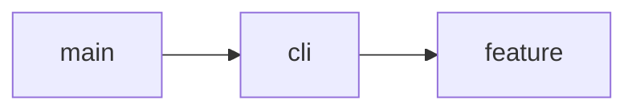

# Architecture

- `cli` — The view layer, built with clap. `main` calls `cli::router::run`; each command gets its own file under `cli/`. No logic lives here.
- `feature` — Where all domain logic lives: the agent loop, model access, tools.
